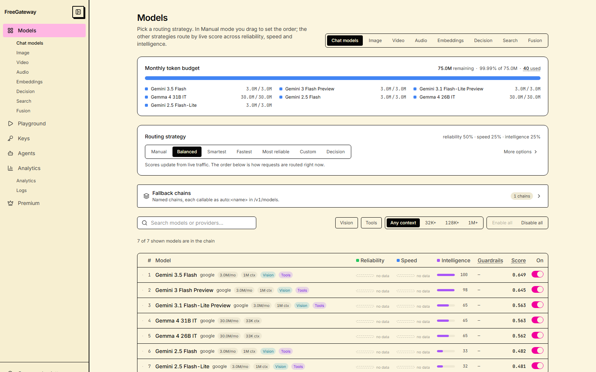
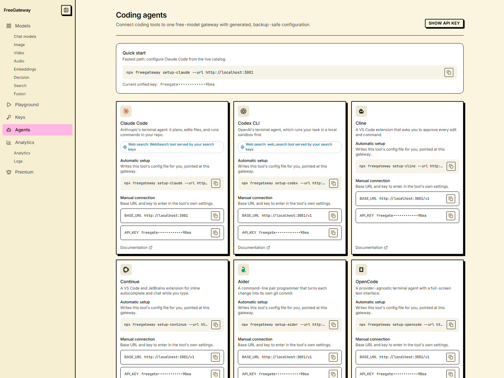

<div align="center">

# FreeGateway

**One OpenAI-compatible endpoint. Every free LLM provider. Your own router.**

A local-first gateway that stacks the free tiers of dozens of AI providers behind a
single `/v1` API, routes each request to the healthiest model, and fails over
automatically when a provider rate-limits you.

[](https://github.com/adnane007al/freegateway/actions/workflows/ci.yml)
[](./LICENSE)
[](https://github.com/adnane007al/freegateway/actions/workflows/desktop-release.yml)

</div>

---

## What it does

Every serious AI lab now offers a free tier — a few million tokens a month, a few
thousand requests a day. On its own each tier is a toy. Stacked together they add up to
real working capacity — but each one is a different SDK, a different rate limit, and a
different place a request can fail.

FreeGateway collapses that into one endpoint:

- **One API.** Point any OpenAI-compatible client at `http://localhost:3001/v1`.
- **One key.** Provider keys are encrypted in your local SQLite database; your apps only
  ever see a single unified bearer token.
- **Smart routing.** Live reliability / speed / intelligence scores rank your chain.
  On a `429` or `5xx` the router cools that key down and retries the next model.
- **Quota-aware.** Per-key RPM / RPD / TPM / TPD counters learn each provider's real
  ceilings, so routing stays under every cap.
- **Self-contained.** Runs on your machine, in Docker, or as a native desktop app.

## Screenshots

**Models** — pick a routing strategy and watch the monthly token budget across the whole
provider fleet. The order below is how requests route right now.



**Agents** — configure any coding agent in one command, or copy the base URL and API key
separately into the tool's own settings.



## Supported surfaces

| Surface | Endpoint |
| --- | --- |
| Chat completions | `/v1/chat/completions` |
| Responses (Codex CLI) | `/v1/responses` |
| Legacy completions | `/v1/completions` |
| Anthropic Messages (Claude Code) | `/v1/messages` |
| Gemini native | `/v1beta/*` |
| Ollama emulation (opt-in) | `/v1/ollama/*` |
| Images | `/v1/images/generations` |
| Videos | `/v1/videos/generations` |
| Speech | `/v1/audio/speech` |
| Transcriptions | `/v1/audio/transcriptions` |
| Embeddings | `/v1/embeddings` |
| Model catalog | `/v1/models` |
| MCP server | `/mcp` |
| OpenAPI viewer | `/v1/docs` |

Plus: tool calling and structured outputs, streaming, vision input, Google Search
grounding, fusion (multi-model synthesis with a judge), sticky sessions, opt-in prompt
compression, response caching, and an MCP server your agents can introspect mid-session.

## Providers

**86 provider adapters** ship in the box — Google, Groq, Cerebras, NVIDIA, Mistral,
OpenRouter, Cloudflare, Cohere, Z.ai (Zhipu), Hugging Face, ModelScope, OpenRouter
aggregators, Chinese domestic clouds, and a **custom** provider for any
OpenAI-compatible endpoint (llama.cpp, LM Studio, vLLM, a local Ollama, or a remote
gateway).

The full live catalog — every model, its context window and its free-token budget —
lives at [freegateway.co/models](https://freegateway.co/models.html).

## Quick start

### Desktop app (Windows / macOS / Linux)

The whole router + dashboard runs locally from your tray.

1. Download the latest installer from
   [Releases](https://github.com/adnane007al/freegateway/releases/latest).
2. Open it and add your provider keys on the **Keys** page.
3. Copy the unified API key from the tray popover.

> On Windows, an unsigned build triggers a SmartScreen warning — click **More info →
> Run anyway**.

### Docker

```bash
curl -fsSL https://freegateway.co/install.sh | bash
```

That sets up `~/freegateway`, generates an encryption key, pulls the image and starts the
container. Re-running it is safe — your `.env` and encryption key are preserved.

Open <http://localhost:3001>, add your provider keys, and grab the unified API key from
the **Keys** page header.

### From source

```bash
git clone https://github.com/adnane007al/freegateway.git
cd freegateway
npm install
npm run dev
```

- API server → <http://localhost:3001>
- Dashboard → <http://localhost:5173>

For a repeatable setup use `./scripts/dev-bootstrap.sh` (Bash) or
`.\scripts\dev-bootstrap.ps1` (PowerShell) — each preserves an existing `.env`.

## Using the API

```python
from openai import OpenAI

client = OpenAI(
    base_url="http://localhost:3001/v1",
    api_key="freegateway-your-unified-key",
)

resp = client.chat.completions.create(
    model="auto",  # or "auto:fast", "auto:smart", a profile, or a model id
    messages=[{"role": "user", "content": "Summarise the fall of Rome in one sentence."}],
)
print(resp.choices[0].message.content)
print("Routed via:", resp.headers.get("x-routed-via"))
```

Every response carries an `X-Routed-Via: <platform>/<model>` header so you can see which
provider actually served it.

## Coding agents

Most agents configure themselves with one command that reads your live catalog, backs up
the existing config and merges into it:

```bash
npx freegateway setup-claude --url http://localhost:3001 --api-key <unified-key>
```

Supported out of the box: Claude Code, Codex CLI, Gemini CLI, Cursor, Cline, Roo Code,
OpenCode, Aider, Continue, Goose, Qwen Code, Kilo Code, Crush, Zed, JetBrains AI,
DeepSeek Harness, MiMo Code, AtomCode, OpenClaw, Hermes Agent, Pi, Reasonix, ZCode — and
any OpenAI-compatible, Anthropic, Gemini or Ollama client.

## CLI

```bash
npx freegateway list                          # supported tools and their base URLs
npx freegateway setup-codex --url ... --api-key ...
npx freegateway launch --url ... --api-key ... # run Claude Code with credentials injected
npx freegateway keys add|list|remove|test <platform>
```

Full reference: [`cli/README.md`](./cli/README.md).

## Project layout

```
.
├── server/     # Express API, router, providers, SQLite layer, migrations
├── client/     # React + Vite dashboard (60 locales, light/dark themes)
├── cli/        # the `npx freegateway` command-line tool
├── shared/     # types shared across workspaces
├── desktop/    # native tray app (Electron)
├── landing/    # static landing page (GitHub Pages)
├── docs/       # install, API, clients, architecture documentation
└── scripts/    # dev bootstrap helpers
```

## Tech stack

Node 20.18+ · TypeScript · Express · SQLite (better-sqlite3) · React · Vite · Tailwind ·
Vitest · pnpm workspaces · Docker · Electron.

## Development

```bash
npm install          # install workspaces
npm run dev          # server on :3001 + dashboard on :5173
npm test             # bootstrap, hooks, server, cli and client suites
npm run lint         # server + cli
npm run build        # build server, cli and client
npm run desktop:dev  # build the client, then run the tray app
```

Database migrations:

```bash
npm run db:migration:status
npm run db:migration:create -- --name what_changed
npm run db:migration:up
npm run db:migration:down
npm run db:migration:fresh
```

## Releases

The **Desktop release** workflow builds Windows, macOS (arm64 + x64) and Linux
installers and attaches them to the GitHub Release for the pushed tag. To publish a new
version:

1. Bump `version` in `desktop/package.json` **and** `desktop/package-lock.json` — the
   desktop test suite asserts the two match.
2. Commit, tag with the matching `vX.Y.Z`, and push the tag.
3. The workflow builds, attaches the installers and publishes the release.

## Documentation

- [Install & deploy](docs/en/install/01-install.md)
- [REST API reference](docs/en/api/01-rest-api.md)
- [Clients & coding agents](docs/en/clients/01-agent-clients.md)
- [Architecture & internals](docs/en/architecture/00-high-level-index.md)
- [Documentation index](docs/en/README.md)
- [Contributor guide](CONTRIBUTING.md)

## Limitations

Stacking free tiers has real trade-offs: no frontier models, variable latency, no SLA —
and the effective intelligence of the endpoint dips late in the day as top models hit their
daily caps, then resets at UTC midnight. Read the honest list in
[docs/en/architecture/00-high-level-index.md](docs/en/architecture/00-high-level-index.md#limitations)
before building anything real on this.

## Contributing

Contributions are welcome — see [CONTRIBUTING.md](./CONTRIBUTING.md) for the dev loop,
PR expectations and the policy on AI/LLM-assisted contributions. A good first PR:

- **Add a provider** — copy `server/src/providers/openai-compat.ts` as a template, wire it
  into `server/src/providers/index.ts`, and add a test in `server/src/__tests__/providers/`.
- **Improve the router** — cost-aware routing, latency-weighted priority, regional pinning.
- **Dashboard polish** — charts on the Analytics page, key rotation UX, batch key import.
- **Docs** — more examples, client snippets for Go/Rust, deployment recipes.

## Credits & license

FreeGateway is MIT licensed — see [LICENSE](./LICENSE).

This repository is a maintained fork of the original
[FreeGateway](https://github.com/tashfeenahmed/freegateway) by Tashfeen Ahmed, which is
MIT licensed and remains the upstream project this work builds on.
